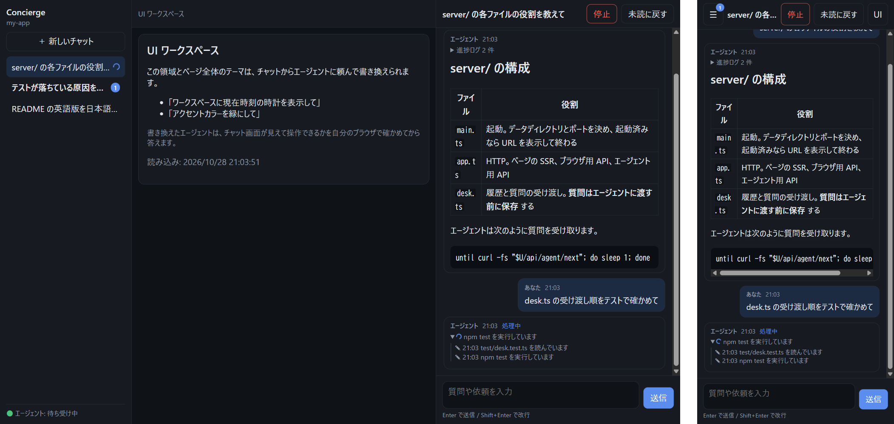

# skill-concierge

ブラウザのチャットからエージェントに質問・依頼できる skill（omp / Claude Code / Codex）。



- 起動すると `127.0.0.1` だけで待ち受けるチャットサーバーが立ち上がる。サーバーもブラウザ側も remix v3（router・render middleware・asset server・`remix/component` の SSR と hydration）で書いている
- サーバーはエージェントを起動せず、CLI も持たない。答える側のエージェントは HTTP API から `curl` で次の質問を受け取り、進捗と答えを書き込む。誰がどう答えるか（自分で答える、subagent に任せる、相談する）は答える側に任せる
- 処理中は答える側が `progress` で何をしているかを書き込み、ブラウザは 1.5 秒ごとに状態を取り直して表示する
- 質問は答える側に渡す前に保存する。返答中に送った次の質問は「待機中」として残り、前の返答が終わると順に渡る。「停止」は返答中の 1 件だけを止め、サーバーを再起動しても待機中・処理中の質問は失われない（処理中だったものは配り直す）
- 履歴はデータディレクトリの JSON ファイル（`chats.json`）に保存し、返答は Markdown（GFM、日本語の `**強調**` 対応）で表示する
- 新着のあるチャットはサイドバーの件数バッジとタブタイトル `(N) <プロジェクト名> · Concierge` で分かる。開いているチャットは既読になる。チャット欄の上の「未読に戻す」で最後の返答を未読に戻せる（開き直すか送信するまで未読のまま）
- 画面は OS のライト／ダークモードに合わせて切り替わり、スマホでは 1 画面ずつ（チャット一覧はドロワー、UI ワークスペースは切り替え）表示する
- チャットから「UI ワークスペース」とページ全体のテーマ（`theme.css`）を書き換えられる。ワークスペースにはメモ・ToDo・設定画面のような操作して使う道具も置け、入力した内容は `store.js` でサーバー（データディレクトリの `ui-data/`）に保存されるので、リロードや別の端末でも残り、エージェントも読める。サーバーは書き換えを検査しない。チャット欄が使えるかは、書き換えた側が `ui.md` の手順で自分のブラウザで確かめる。チャット画面本体（`app/`）は起動時にコンパイルした内容だけを配信するので、ディスク上で書き換えられても動いている画面には影響しない

## 構成

| パス | 内容 |
|---|---|
| `skills/skill-concierge/SKILL.md` | エージェントが最初に読む運用手順: 起動、待ち受けのループ、subagent への任せ方、停止、よくある間違い |
| `skills/skill-concierge/reference.md` | 必要なときに引く資料: API 一覧、curl のレシピ、サーバーの起動オプションとデータ、他の端末からの利用、トラブル対応 |
| `skills/skill-concierge/answering.md` | 1 つの質問に答える手順（エージェントの種類を問わない）。subagent に渡す |
| `skills/skill-concierge/ui.md` | UI を書き換える質問のときに読む資料: 書き換えられるファイル、ワークスペースの sandbox でできること・できないこと、`theme.css` で使える変数とセレクタ、確認手順、初期状態への戻し方 |
| `skills/skill-concierge/server/` | 起動（`main.ts`: データディレクトリとポートの決定・既存サーバーの検出）、HTTP（`app.ts`）、履歴と質問の受け渡し（`desk.ts`）。TypeScript を Node.js がそのまま実行する |
| `skills/skill-concierge/codex/concierge.config.toml` | Codex を full access なしで使うための permission profile（下の「権限と sandbox」） |
| `skills/skill-concierge/app/` | チャット画面（remix v3）。`page.tsx` が文書を SSR し、`public/` 以下（`concierge.tsx` の client entry、`markdown.ts`、`app.css`）を asset server がブラウザ向けにコンパイルする |
| `skills/skill-concierge/template-ui/` | 書き換え可能な UI の初期内容 |
| `ci/` | LLM API を呼ばずに omp / Claude Code / Codex で skill を通しで動かす試験（下の「CI」） |

サーバーはプロジェクトごとに 1 つ立ち、ポート・スレッド・UI はプロジェクト間で混ざらない。ポートは固定しない: 前回そのプロジェクトで使ったポートが空いていればそれを使い、無ければ OS が選んだ空きポートを使う（`--port N` で固定もできる）。実行時データはプロジェクトごとに `~/.local/state/skill-concierge/projects/<ディレクトリ名>-<実パスのハッシュ>/`（`XDG_STATE_HOME` があればその下）に置き、対象のプロジェクトには何も書かない: 履歴 `chats.json`、書き換え可能な UI（`ui/`）、ワークスペースの保存データ（`ui-data/`）、`server.json`（URL・PID）と `lock`（起動中のみ。同時に起動しても 1 つだけが立つ）、`port`（前回のポート）。`CONCIERGE_DATA_DIR` を指定するとその 1 か所に固定される。

## 必要なもの

- Node.js 24.3 以上（24.17 で確認）
- omp（18.12.6 で確認）、Codex CLI（0.165.0 で確認）、Claude Code（2.1.312 で確認）のいずれか。いずれも full access なしで動く（下の「権限と sandbox」）

```sh
cd skills/skill-concierge
npm install
npm test        # Markdown の無害化と CJK 強調、履歴の永続化・再起動時の配り直し・受け渡し順・停止・既読の単体テスト
npm run typecheck
```

ビルド手順は無い。サーバーの `.ts` は Node.js の型除去でそのまま動き、起動時に `remix/node-tsx` で TSX を読み込み、ブラウザ向けのモジュールと CSS を asset server で一度だけコンパイルして以後はそれを配信する。

## 起動

### エージェントから

インストール後、対象プロジェクトのディレクトリでエージェントを起動し、skill を呼ぶ（omp: `/skill:skill-concierge`、Claude Code: `/skill-concierge`、Codex: `$skill-concierge`）。omp と Claude Code は待ち受けをバックグラウンドコマンドで行い、Codex は同等の機能が無いので、時間を区切ったフォアグラウンドの待ち受けを繰り返し、止めるよう言われるまで答え続ける。

エージェントは SKILL.md に従って、プロジェクトのディレクトリでサーバーを常駐プロセスとして起動し、URL を返す。sandbox の中のエージェント（Codex、sandbox を有効にした Claude Code）はサーバーを自分では起動せず、`--status` で起動済みのサーバーを探し、無ければ端末での起動を頼む（sandbox の中で起動したサーバーにはブラウザから届かないため）。続けて次の質問を async で待ち受け、届いたら自分で答えるか subagent に任せて、すぐ待ち受けを再開する。subagent が親エージェントの文脈や判断を必要とするときは、返答せずに親に戻し、親が判断して答える。誰も待ち受けていない間に送られた質問は「待機中」のまま残る。

別のプロジェクトで同時に使うときは、そのプロジェクトのディレクトリでサーバーを起動する。別のポートに別の UI が立ち、サイドバーとタブタイトルにプロジェクト名が出る。

### インストール

repo を clone し、skill ディレクトリを使うエージェントの skills に置く（コピーでもリンクでもよい）。

```sh
git clone https://github.com/nkowne63/skill-concierge.git
cd skill-concierge/skills/skill-concierge && npm install
# skill ディレクトリを、使うエージェントの skills に置く（コピーでもよい）
ln -s "$PWD" ~/.omp/agent/skills/skill-concierge     # omp
ln -s "$PWD" ~/.claude/skills/skill-concierge        # Claude Code
ln -s "$PWD" ~/.agents/skills/skill-concierge        # Codex
```

### 権限と sandbox

どのエージェントも full access（Codex の `danger-full-access`、Claude Code の `bypassPermissions`）は要らない。答える側に要るのは `127.0.0.1` への HTTP（`curl`）だけで、UI を書き換えるときはデータディレクトリへの書き込みも要る。以下の設定がそれ以上を許すかどうかは項目ごとに書く。

- **Codex**: 既定の `workspace-write` sandbox は `127.0.0.1` への接続も遮る。同梱の permission profile を使うと、workspace の sandbox のまま `127.0.0.1` / `localhost` とデータディレクトリだけを許す（インターネットは遮ったまま）。設定の `sandbox_mode` が `danger-full-access` でも、このセッションでは profile が優先する。`network_proxy` は Codex 0.165 では experimental

  ```sh
  cp skills/skill-concierge/codex/concierge.config.toml ~/.codex/
  codex -p concierge
  ```

  sandbox の中ではサーバーを起動できないので、プロジェクトのディレクトリで先に `node <skill>/server/main.ts` を端末から起動しておく（またはエージェントの「sandbox の外で実行」の要求を承認する）。
- **Claude Code（sandbox なし、既定）**: 確認なしで答えられるよう、`.claude/settings.json`（ユーザーかプロジェクト）で次を許可する。

  ```json
  { "permissions": { "allow": ["Bash(curl:*)", "Bash(sleep:*)"] } }
  ```

  サーバーの起動（`node …/server/main.ts`）は最初の 1 回だけ承認する。

  ただし `Bash(curl:*)` は `127.0.0.1` への HTTP に限らず、curl でできることすべて（`file://` でのファイル読み取り、`-o` での書き込み、外部への送信）を確認なしで許す。エージェントが読んだ Web ページやファイルに仕込まれた指示（prompt injection）に従った `curl` も止まらない。避けたいなら、この許可を入れずに都度承認するか、ネットワークを `127.0.0.1` だけに絞れる下の sandbox を使う。

- **Claude Code（`/sandbox` を有効にしたとき）**: sandbox の proxy に `127.0.0.1` を許可する。Linux では `bubblewrap` と `socat` が要る。サーバーは Codex と同じく端末から起動しておく。

  ```json
  { "sandbox": { "enabled": true, "network": { "allowedDomains": ["127.0.0.1", "localhost"] } } }
  ```

  sandbox は `NO_PROXY` に `127.0.0.1` を入れるため、そのままの `curl` は proxy を通らず届かない。SKILL.md の指示で、エージェントは `curl --noproxy ''` を使う。
- **omp**: sandbox は無い。

### 手動で

プロジェクトのディレクトリで `node <repo>/skills/skill-concierge/server/main.ts` を実行する。質問・待ち受け・回答の curl は `skills/skill-concierge/reference.md` の「Recipes」にある。ブラウザで送った質問も curl で送った質問も同じスレッドに並ぶ。

## 確認手順

答える側（omp など）が待ち受けている状態で、短い依頼で確かめる。LLM を使わずに試すなら、reference.md の curl を手で実行すればよい。

| # | 確認すること | 手順 | 期待結果 |
|---|---|---|---|
| 1 | 応答 | URL を開き、入力欄に「`skills/skill-concierge/package.json` の name を一言で」と送る | 待ち受けに質問が届き、答える側（またはその subagent）の進捗と返答がチャットに出る |
| 2 | 親への伝達と返却 | 「親エージェントに『今日の合言葉は？』と問い合わせて答えて」と送る | 親エージェントが subagent に任せた場合、subagent は返答せず親に戻し、親が判断した内容で返答が出る |
| 3 | 返答中の送信 | 返答中にもう 1 通送る | 2 通目はすぐ表示され、返答枠が「待機中」になる。前の返答が終わると待ち受けに渡り、順に答えが出る |
| 4 | 停止と再起動 | 返答中に「停止」を押す。別の返答中にサーバーを止めて起動し直す | 止めた返答は「中断」、その後ろの待機中の質問は残って次に渡る。止められた側の `progress` / `answer` は HTTP 409 で失敗する。再起動時に処理中だった返答は待機中に戻って配り直され、履歴は残る |
| 5 | Markdown | 見出し・箇条書き・表・コード・`**「強調」**` を含む返答を頼む | それぞれ描画される。返答中の生 HTML は文字列のまま表示される |
| 6 | 新着の判別 | チャット A で依頼を送ってすぐ「＋ 新しいチャット」や別チャットに移る | A の返答が終わるとサイドバーの A に件数バッジ、タブタイトルが `(1) <プロジェクト名> · Concierge` になる。A を開くと消える |
| 7 | 逐次進捗 | 「`server/desk.ts` と `server/app.ts` を読んで役割を 1 行ずつ」と送る | 処理中の返答に、`progress` で書かれた行（✎）が順に増える。完了後は「進捗ログ N 件」に畳まれる |
| 8 | UI 書き換え | 「UI ワークスペースに秒まで出る時計を表示し、アクセントカラーを緑にして」と送る | 数秒以内に再読み込みなしで時計と緑のアクセントが反映される。返答に、変更内容と、PC 幅・スマホ幅 × ライト・ダークでチャット欄を確かめた結果が書かれる |
| 9 | プロジェクトごとの UI | 別のディレクトリ B でサーバーを起動する | B は別のポートに立ち、別のデータディレクトリを使う（起動時に表示）。B の画面にはプロジェクト名 B が出て、A のチャットは出ない |
| 10 | ライト／ダーク | OS（またはブラウザ）の外観設定を切り替える | 再読み込みなしでチャット画面と UI ワークスペースの配色が切り替わる |
| 11 | スマホ | スマホ（または幅 390px 程度）で開く | チャットが全画面で出る。左上の ☰ でチャット一覧のドロワー（新着件数つき）、右上の UI でワークスペースに切り替わる。タッチキーボードの Enter は改行で、送信はボタン |

## CI

LLM API は呼ばない。

- `ci.yml`: push と pull request ごとに `npm run typecheck` と `npm test`
- `agents.yml`: 毎日 npm で omp（`@oh-my-pi/pi-coding-agent`）・Claude Code（`@anthropic-ai/claude-code`）・Codex（`@openai/codex`）の最新版を調べ、まだ試していない版があればその版を入れて `node ci/agent-e2e.ts <omp|claude|claude-sandbox|codex>` を走らせる（版と skill / ci のハッシュごとに結果を cache に記録し、同じ組み合わせは試し直さない）。手動実行（`force`）と、`skills/**`・`ci/**` を変えた main への push でも走る
- `ci/agent-e2e.ts` は、エージェントのモデルの接続先を `ci/mock-llm.ts`（Anthropic Messages API / OpenAI Responses API の台本どおりに応える偽物）に向け、本物のエージェントの CLI を動かす。確かめるのは次のこと
  - skill が見つかり、その説明がモデルへの要求に入っていること（skill の置き場や読み込み方の変化を捕まえる）
  - エージェントのシェル実行で SKILL.md の手順（待ち受け・進捗・回答の `curl`）が通り、チャットに回答が載ること
  - full access なしで通ること（Codex は同梱の profile、Claude Code は `Bash(curl:*)`・`Bash(sleep:*)` の許可ルールだけの場合と sandbox の場合の 2 通り）
  - 本物のモデル API への接続が無いこと

  モデルの判断（どう答えるか）は試さない。台本は固定なので、エージェントが SKILL.md をどう読むかの変化は捕まえない。

## 他の端末から開く

サーバー自体は `127.0.0.1` のままにし、`--allow-host <公開名>` と `--port N`（中継先を固定するため）を付けて起動したうえで `tailscale serve` などで中継する（手順は reference.md の「Access from other devices」）。その名前に届く人は誰でも、待ち受けているエージェントに作業を頼めるので、必要なときだけ開く。

## セキュリティ

**自分の PC で、自分だけが使う前提で作っている。** 同じ PC の他のユーザーやプロセス、ブラウザで開いた他のページからの悪用は防ぎきれない。具体的には次のことが起きうる。

- 認証は無い。このポートに届くもの（同じ PC の他のプロセス、tailscale serve や Cloudflare などの中継）は誰でも質問も回答もでき、エージェントが処理中の質問に別の回答を書き込むこともできる。外に出すときは中継側で認証をかける
- 別オリジンからの書き込みの拒否はホスト名で判定しているので、同じ PC の別のポートで動く `localhost` のページからは質問を投稿できる。質問はシェルを持つエージェントへの指示になる
- 状態を変える GET（`/api/agent/next` など）は送信元を確かめないので、ブラウザで開いた他のサイトからでも、中身は読めないが、質問を受け取り済みにしたり新着を消したりはできる
- データディレクトリのファイルは umask のとおりに作られる（多くの環境では同じ PC の他のユーザーから読める）

共有の PC や、他人も入れるネットワークに公開する使い方はしない。

その前提の上で、次の対策をしている。

- `127.0.0.1` のみで待ち受け、`Host` が `127.0.0.1` / `localhost`（と `--allow-host` の名前）以外のリクエストを拒否する
- 同じ起動が重なっても、1 つのデータディレクトリで動くサーバーは 1 つだけ（`lock`）
- 書き換え可能な UI は CSP sandbox の iframe（opaque origin）で動き、チャット画面の DOM や API の応答を読めない。ページ全体に効くのは `theme.css` だけ
- `/ui/*` は UI ディレクトリの中にある通常ファイルだけを返し、外を指す symlink は辿らない（404）。`/ui-data/*` は symlink を辿らずに読み、書き込みは一時ファイルからの rename で置き換えるので、symlink の先を読むことも上書きすることもない
- ワークスペースの保存先（`/ui-data/*`）は、どのオリジンからも読み書きできる（sandbox の中からの要求は送信元が `null` になるため）。ブラウザで開いた他のサイトからもワークスペースのデータは読み書きできるが、チャットと回答の API には届かない

## ライセンス

[MIT](LICENSE)
